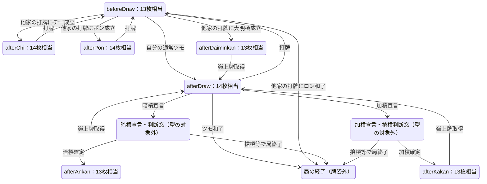

# ツモ・鳴き・槓を区別する牌姿の設計案

作成日: 2026-11-28

関連: [共有牌姿表現の設計](./shared-hand-representation-design.md)、
[牌姿キーの計画](./hand-perfect-hash-plan.md)、
[HandSnapshot設計レビュー](./hand-snapshot-review-2026-11-26.md)

## 目的と現状

13枚相当と14枚相当の牌姿を同じ型で扱いながら、ツモ牌や直前の鳴き・槓を
区別できるようにする。チー・ポン・大明槓では鳴いた牌を赤5と通常5まで区別し、
ポン・明槓では鳴き元も保持する。

現在のCoreの[`HandSnapshot`](../mahjong-domain-core/MahjongDomain/HandSnapshot.lean)は
37種の手元カウントと固定面子リストを持つが、ツモ牌や直前に鳴いた面子を識別しない。
[`FixedMeld`](../mahjong-domain-core/MahjongDomain/HandSnapshot.lean)は面子のshape、
鳴き情報、赤牌を含む牌構成を保持するが、鳴いた実牌の個体IDは保持しない。
チーでは鳴き位置と牌構成から鳴いた37種を特定できるが、ポン・大明槓では
赤5を鳴いたのか手元から使ったのかを面子の構成だけでは特定できない。
この文書は**未実装の設計案**であり、打牌イベントや牌譜再生の実装を意味しない。

## 牌姿と段階

`Option Tile37`だけでは、ツモなしの13枚相当と、チー・ポン直後のツモなしの
14枚相当を区別できない。また「ツモ牌がない」と「情報が不明」を混同する。
そこで、単なる有無ではなく直前の状態を表す直和型を使う。

下記は候補の概念的な形であり、名前・実装方式は未確定である。

```lean
inductive HandPhase
  | beforeDraw
  | afterDraw (tile : Tile37)
  | afterChi (meld : FixedMeld) (calledTile : Tile37)
  | afterPon (meld : FixedMeld) (calledTile : Tile37)
  | afterDaiminkan (meld : FixedMeld) (calledTile : Tile37)
  | afterAnkan (meld : FixedMeld)
  | afterKakan (meld : FixedMeld)
  | unknown

structure PhasedHandSnapshot where
  snapshot : HandSnapshot
  phase : HandPhase
```

`beforeDraw`は通常の打牌後などの13枚相当の安定状態を表す。
`afterDraw`は通常のツモまたは嶺上牌取得後、`afterChi`・`afterPon`は鳴いた直後の
打牌前を表す。`afterDaiminkan`・`afterAnkan`・`afterKakan`は**槓確定後、
嶺上牌取得前**を表し、加槓宣言中の搶槓判断窓は含めない。`unknown`は段階が
不明な情報を表し、`beforeDraw`や「ツモ牌が存在しない」という事実と同一視しない。
ツモ後であることは分かるがツモ牌が不明などの部分的な欠落を区別したい場合、
この候補の`unknown`だけでは情報を失う。別途型を拡張するか、入力の欠落情報を
保持する表現を設計する。
親の配牌完了直後などの扱いは入力形式・ルールに応じて別途定義し、推測しない。

現時点では既存`HandSnapshot`を包む案を推奨する。段階を持たない既存の牌姿概念と
consumerを維持しつつ、13枚相当・14枚相当をどちらも`PhasedHandSnapshot`で表せる。
`HandSnapshot`自体にフィールドを追加する案もあり、共有APIの互換性・同一性と利用方法を
比較して実装前に決定する。いずれの場合も段階を含む構造の意味はCoreで共有し、
キーや計算への使い方はconsumerで扱う。

## アクションと段階の遷移図

次は**一人のプレイヤーの牌姿**を追う概念図であり、局全体の状態機械ではない。
矢印のラベルは遷移を引き起こすイベント、ノードはそのイベント後の`HandPhase`を
表す。`beforeDraw`は他家の手番や打牌への応答を待つ間も含み、「直ちに自分が
ツモできる」ことを意味しない。ルール上の条件を満たし、鳴きの優先順位などが
確定したときに限り該当する矢印を進む。



図中の「判断窓」と「局の終了」は`HandPhase`の候補ではない。槓宣言から確定までの
状態、搶槓の可否と処理は局面・イベント層の責務であり、暗槓に対する搶槓等は
適用ルールによる。大明槓についても、宣言・優先順位の解決・成立の間の状態は
図の`afterDaiminkan`には含まれない。局の終了は和了・流局等によっても発生し得る。
`unknown`は入力情報の欠落を表すため図から省略し、自動的な遷移先とみなさない。
配牌完了直後の親や局開始・終了処理も、この図から決めない。

図は牌姿を変化させる代表的なイベントを示す。他家のツモ・打牌や見送りなど、
自分の牌姿を変えないイベント、立直宣言や槓ドラ公開など局面に影響するイベントも
存在するが、`HandPhase`だけではその処理順序や合法性を判断できない。
打牌時の立直や、鳴いた牌に関する制限などもルール・履歴側で扱う。

| イベント | 牌姿への変更 | 結果の段階 |
|---|---|---|
| 通常ツモ・嶺上牌取得 | 手元に取得した`Tile37`を1枚加える | `afterDraw`に同じ牌を指定 |
| 打牌 | 手元から捨てた`Tile37`を1枚除く。ツモ切り／手出しは打牌結果に記録 | `beforeDraw` |
| チー・ポン成立 | 手元から使った2枚を除き、他家の打牌を含む3枚の固定面子を追加 | `afterChi` / `afterPon`に面子と鳴いた牌を指定 |
| 大明槓成立 | 手元から使った3枚を除き、他家の打牌を含む4枚の固定面子を追加 | `afterDaiminkan`に面子と鳴いた牌を指定 |
| 暗槓確定 | 手元から4枚を除き、その4枚の暗槓を追加 | `afterAnkan` |
| 加槓確定 | 手元から追加の1枚を除き、元のポンを加槓に置き換える | `afterKakan` |
| 和了・流局 | 局の終了として扱う。結果や得点などは局面側に保持 | `HandPhase`の対象外 |

これらの操作では実際に移動した37種の牌を用い、手元と面子の間で重複計上しない。
打牌がツモ切りかどうかはイベントから記録し、ツモ牌と捨て牌の牌種が一致した
というだけでは決めない。図に矢印があることは、立直後の槓や食い替えを含む
個々のアクションの合法性を保証しない。

## 決定: 14枚相当を`HandSnapshot`に残す

`HandSnapshot`は引き続き13枚相当と14枚相当の両方を表し、`standing`はツモ牌を
含む現在の手元の全牌を数える。固定面子数を`m`とすると、通常のツモ後は
`standing.total + 3m = 14`である。チー・ポン後の打牌前もツモ牌なしで14枚相当
となるため、14枚相当であることだけからツモ後とは判断しない。

この方式では牌姿そのものを表せるほか、既存の占有牌やシャンテン向け計算で
ツモ牌を追加合算する必要がない。14枚相当の牌姿だけが分かり、ツモ牌が不明な
入力も扱える。一方、`HandSnapshot`だけではどの牌がツモ牌かを区別できず、
同じ牌姿でツモ牌が異なる状態を区別するには、段階情報も含めた比較が必要となる。

段階付き表現では、`afterDraw tile`の`tile`は**既に`snapshot.standing`に含まれる**
ものとする。追加の1枚として二重に合算しない。赤5は`Tile37.akaFive`で、
通常5とは別に指定できる。
例えば`standing`に通常5mが2枚あり`afterDraw`が通常5mなら、そのうち1枚がツモ牌
である。37種の識別は物理牌の個体IDではない。
ツモ牌の指定とカウントが矛盾しないよう、`standing tile ≥ 1`を検証する。

検討した別案は、ツモ牌を`standing`から除いて別に保持する方式である。ツモ牌と
カウントの重複はなくなるが、手元の全牌を使う計算ではツモ牌の合算が必要となり、
既存の手元枚数・占有牌計算やconsumerの変更も伴う。またチー・ポン後はツモなしでも
14枚相当なので、`standing`が常に13枚相当になるわけではない。以上からこの案は採用せず、
現在の全手元牌を`standing`に含める方針とする。

## 鳴いた牌と槓

各`afterChi`・`afterPon`・`afterDaiminkan`の`meld`は、直前の行為で完成した
固定面子を指定する。`calledTile`は他家の捨て牌から鳴いた正確な37種であり、
`meld.tiles`に含まれなければならない。

- **チー**: `meld.shape`の`Shuntsu`と`calledOffset`は鳴いた牌の正規化牌種を
  特定する。`calledTile.normalized`がその位置の牌種と一致し、かつ面子内に
  存在することを検証する。赤5を鳴いた場合と通常5を鳴いた場合を区別する。
- **ポン**: `meld.shape`の`RelativeCaller`が鳴き元を示す。`calledTile`は
  その鳴き牌が赤5か通常5かを示す。
- **大明槓**: `meld.shape`の`RelativeCaller`が鳴き元を示し、`calledTile`が
  赤5か通常5かを示す。現行の通常5最大3枚・赤5最大1枚の容量では、有効な5の
  槓は赤5を1枚含むが、それだけでは赤5を鳴いたかどうか分からない。
- **暗槓**: 他家から鳴く牌や鳴き元はない。4枚の37種構成は`meld.tiles`に含まれる。
- **加槓**: 元のポンを加槓に置き換え、両方を固定面子として数えない。
  `meld.shape`の鳴き元は元のポンの相手であり、加槓時に新たに他家から牌を鳴く
  わけではない。元ポンの鳴き牌や追加した牌をこの段階から復元することは
  保証しない。必要なら履歴を別途保持する。

`meld`のshapeは対応するコンストラクタと一致し、`meld.hasValidComposition`が
真で、`snapshot.fixedMelds`に同じ面子が少なくとも1組存在する必要がある。
リストの位置を参照に使うと、面子の並べ替えで参照が変わるため、面子の値と多重度で
扱う。同一の面子が複数ある場合は同じ値を指定できるが、どの行為で作られた個体かや
履歴順序は識別できない。牌譜のイベントIDなどは別の履歴層に置く。

槓後、嶺上牌を取得すると`afterDraw tile`へ進む。この段階情報だけでは直前に
どの槓があったかは復元できない。自摸の種類や槓の来歴が必要なら、局面情報・
イベント履歴を別途保持する。

## 枚数・妥当性と同一性

固定面子数を`m`、`snapshot.standing.total`を`h`とする。槓は面子数として1組、
物理牌として4枚を占有する。構築可能であることと、次の対象状態として妥当であることは
区別する。

| 段階 | 通常の枚数条件 | その他の条件 |
|---|---|---|
| `beforeDraw` | `h + 3m = 13` | ツモ牌を指定しない |
| `afterDraw tile` | `h + 3m = 14` | `standing tile ≥ 1` |
| `afterChi` / `afterPon` | `h + 3m = 14` | 対象面子・鳴き牌の整合性 |
| 槓確定後・嶺上牌取得前 | `h + 3m = 13` | 対応する槓面子の存在・構成 |
| `unknown` | 特定しない | 不明を他の段階に変換しない |

これらは対象とする通常の安定状態と槓後中間状態の条件であり、配牌途中などすべての
状態に無条件で適用しない。共通して面子数、各面子の構成、手元と面子を合わせた37種
容量も検査する。段階の整合性はルール上の合法性や牌譜上の到達可能性を証明しない。
特に槓が実際に宣言可能か、搶槓窓が終了したかは履歴・ルール側で検証する。

既存`HandSnapshot.Equivalent`と`same`は牌姿だけの同一性であり変更しない案とする。
段階付き牌姿の同一性は、基礎牌姿が等価で、段階の種類・ツモ牌・指定面子・鳴き牌が
それぞれ一致することとする。したがって同じ14枚相当でも異なるツモ牌や
`afterChi`／`afterDraw`は区別される。固定面子の列順は引き続き無視する。
段階を含む比較をCore APIとして提供する場合、同値関係と実行時比較の一致の証明は
別途必要である。

## 打牌結果とキーの境界

段階付き牌姿は判断**前**の状態であり、実際にどの牌を切ったかを持たない。
将来の打牌イベントは、捨てた`Tile37`と打牌元（ツモ切り／手出し／不明）を
保持し、判断前の段階付き牌姿と関連付ける。`afterDraw`でツモ牌と捨て牌が
同じ37種でも、同種の手牌を切った可能性があるため、牌種の一致だけで
ツモ切りと判定しない。チー・ポン直後はツモ牌がないのでツモ切りではない。
結果の整合性として、ツモ切りなら捨て牌はツモ牌と同じ37種であり、手出しなら
ツモ牌を除いた手元に捨てる牌が1枚以上必要である。捨て牌は打牌前の手元から
1枚減らす。不明な打牌元を事実に反して補完せず、可能な範囲の整合性だけを検査する。

既存の牌集合キー・鳴き込みキーは牌姿の射影に使い、段階や打牌元を保持しない。
現行34種の鳴き込みキーは赤牌を含むsnapshotを拒否する。段階を区別する検索には
段階・牌を別に保存するか、別の版付きキー空間を設計する。既存キーからツモ牌や
鳴き牌を復元できると仮定しない。

## 実装前の検証例

1. 同じ13枚相当を`beforeDraw`で表し、ツモ後に手元へ1枚加えて`afterDraw`とする。
   ツモ牌が手元に含まれなければ拒否し、占有牌に二重加算しない。
2. 赤5と通常5をそれぞれツモした状態を区別する。同じ牌種をツモ切りした結果と
   手出しした結果は、段階付き牌姿だけでなく打牌元によって区別する。
3. チー・ポン直後の14枚相当を表す。チーの鳴き位置と鳴き牌の不一致、
   面子に存在しない鳴き牌、対応しない面子種は拒否する。
4. 赤5を含むポン・大明槓で、赤5を鳴いた場合と通常5を鳴いた場合を区別する。
   鳴き元も保持し、存在しない赤牌や通常牌を鳴いたとの指定は拒否する。
5. 暗槓・大明槓・加槓の確定後から嶺上牌取得後へ遷移し、面子数・手元枚数・
   物理牌数を確認する。加槓は元ポンを置き換える。
6. 同じ面子の複数存在・固定面子順の交換、`unknown`、不正な37種容量、
   親の配牌完了直後や搶槓窓など対象外・未決定状態を明示的に扱う。

型の配置・具体的な構築／検証API、履歴と段階の境界、交換形式とキーの版管理は
実装前に決定する。
